 

### 🚀 Featured projects

| | Project | What it does | Stack |
|---|---|---|---|
| 01 | [**axionova-solidity-defi-contracts**](https://github.com/aditya-kumar-k/axionova-solidity-defi-contracts) | Modular DeFi smart contracts for the Axionova ecosystem on BNB Smart Chain | `Solidity` `Hardhat` `OpenZeppelin` |
| 02 | [**Axionova network**](https://axionova.network) | Staking, governance, vesting, presale, an [explorer](https://explorer.axionova.network), a [BTC prediction game](https://axionova.network/btc-prediction/), and the [Axiverse](https://axionova.network/axiverse/) land game | `Solidity` `Chainlink` `Ethers.js` `PHP 8` |
| 03 | [**Roost-Xplorer**](https://github.com/aditya-kumar-k/Roost-Xplorer) | Linux file manager with GTK 4 + libadwaita, dark gray theme, keyboard-friendly | `Python` `GTK4` |
| 04 | [**serien-music-player**](https://github.com/aditya-kumar-k/serien-music-player) | Desktop music player with visualizer, 5-band EQ, and Indic transliteration search | `Electron` `Howler.js` |

Also: [**CodesandKeys**](https://codesandkeys.netlify.app), a cloud-synced vault for API keys, snippets, and licenses.

### 🛠️ Tech stack

  
  
  
  
  
  
  
  
  
  
  
  

### 📊 GitHub stats

  
  
   
  

### 🏆 Achievements

  
  

### ☕ Support

If my work helps you, you can [**buy me a coffee via PayPal**](https://paypal.me/adithyak9).
