 

---

### 👋 About me

I'm a **Blockchain Engineer** based in **Hyderabad, India**, building at the intersection of **AI, blockchain and web development**.

- ⛓️ Smart contracts and Web3 backends with **Solidity** and **Hardhat**
- 🔐 Secure, scalable, modular on-chain architecture
- 🐧 Linux apps, KDE Plasma widgets and desktop customization
- 🤖 Exploring where AI and Web3 meet

### 🛠️ Tech stack

  
  
  
  
  
  
  
  
  
  
  
  

### 🚀 Featured projects

| Project | What it does | Stack |
|---|---|---|
| [**axionova-solidity-defi-contracts**](https://github.com/aditya-kumar-k/axionova-solidity-defi-contracts) | Modular DeFi smart contracts for the Axionova ecosystem on BNB Smart Chain | `Solidity` `Hardhat` `OpenZeppelin` |
| [**Roost-Xplorer**](https://github.com/aditya-kumar-k/Roost-Xplorer) | Linux file manager with GTK 4 + libadwaita, dark gray theme, keyboard-friendly | `Python` `GTK4` |
| [**serien-music-player**](https://github.com/aditya-kumar-k/serien-music-player) | Desktop music player with visualizer, 5-band EQ and Indic transliteration search | `Electron` `Howler.js` |

### 📊 GitHub stats

  
  
   
  

### 🔝 Top Contributed Repo

### 🔝 Top Repositories

### ✍️ Random Dev Quote

### 🏆 Achievements

  
  

### ☕ Support

If my work helps you, you can [**buy me a coffee via PayPal**](https://paypal.me/adithyak9).

  

